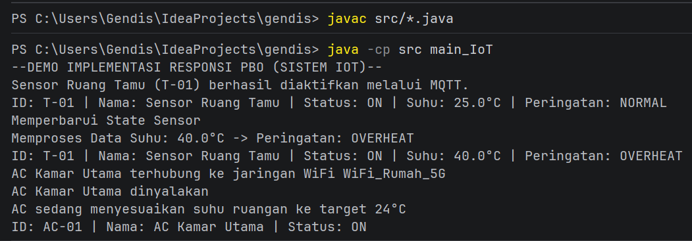

# Responsi Praktikum PBO - Smart IoT System

**Nama**: Sekar Gendis Maheswari

**NIM**: H1D025004

**TEMA**: Sistem IoT (digit terakhir 4 dan 5)

## Deskripsi Sistem
Sistem simulasi **Smart IoT System** dengan Java untuk mengelola sensor suhu (`SmartThermometer`) dan AC pintar (`SmartAirConditioner`). Sistem ini mengimplementasikan 10 persyaratan teknis responsi.
1. **State & Behavior**: Atribut internal (`idPerangkat`, `nama`), method `void` (`aktifkanPerangkat()`), dan return `getInfoPerangkat()`.
2. **Immutability**: `public static final String PROTOCOL` & `private final String idPerangkat`.
3. **Enkapsulasi & Overloading**: Atribut `private`, getter/setter, keyword `this`, dan overloaded constructor.
4. **Inheritance**: Subclass (`SmartThermometer`, `SmartAirConditioner`) menurunkan `IoTDevice`. Class `main_IoT` dipisah.
5. **Super Chaining**: Pemanggilan `super(...)` pada konstruktor dan `super.getInfoPerangkat()`.
6. **Method Overriding**: Penggunaan `@Override` pada `processData()` dan `getInfoPerangkat()`.
7. **Abstract Class**: Class `IoTDevice` berstatus `abstract` dengan abstract method `processData()`.
8. **Logika State Percabangan**: Percabangan `if/else` pada `processData()` untuk mengubah `statusPeringatan`.
9. **Polimorfisme Interface**: Referensi bertipe interface (`Connectable wifi = acRuangan;`).
10. **Multiple Interface**: Class `SmartAirConditioner` mengimplementasikan `Connectable` dan `PowerManageable`.

## Petunjuk Pengujian untuk Asisten Praktikum (Compile & Run)

```bash
# 1. Perintah untuk mengompilasi seluruh file Java (.java) di dalam folder src
javac src/*.java

# 2. Perintah untuk mengeksekusi class main_IoT dengan mengarahkan classpath (-cp) ke folder src
java -cp src main_IoT
```

## Screenshoot Luaran Program
